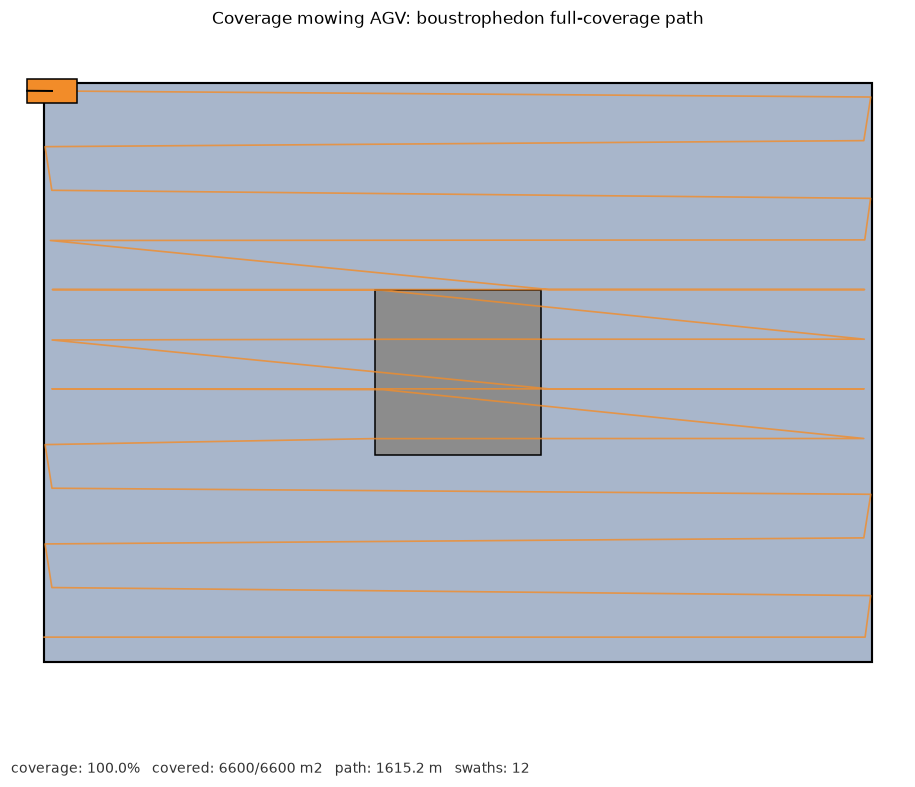

# 区域全覆盖往复清扫 AGV 仿真（牛耕式路径）

纯 NumPy + Matplotlib 实现的二维全覆盖路径规划仿真，不依赖 ROS / Gazebo / CARLA /
MuJoCo。给定矩形作业区与一处矩形障碍，按牛耕式（boustrophedon）往复条带规划
覆盖路径，小车沿梳齿路径逐行清扫，1 m 网格统计已覆盖面积并计算覆盖率；穿越
障碍所在条带时自动绕开障碍区段。

- 源码：[`src/ground/coverage_mowing_agv`](../../src/ground/coverage_mowing_agv)
- 作者：jiangdong000

## 环境

- Python 3.8+（纯 Python，跨平台；Linux / Windows / macOS 均可运行）
- NumPy、Matplotlib（见模块 `requirements.txt`）

```bash
pip install -r src/ground/coverage_mowing_agv/requirements.txt
```

## 运行

```bash
python3 src/ground/coverage_mowing_agv/main.py --demo --outdir demo_out
```

无窗口评测：

```bash
python3 src/ground/coverage_mowing_agv/main.py --headless --duration 300 --outdir demo_out
```

## 覆盖路径规划

- 清扫带宽 `SWATH = 6 m`，条带中心线沿 y 方向每隔 6 m 一条；
- 偶数条带左→右、奇数条带右→左，蛇形换向衔接；
- 障碍所在 y 区间内的条带拆成障碍左右两段，绕过矩形障碍；
- 小车沿路径点巡航，覆盖统计以车位为中心、带宽半径（含半格余量）内的可作业
  网格置为已覆盖；障碍网格不计入分母。

覆盖率：

```
coverage = 已覆盖网格数 / (总网格数 - 障碍网格数)
```

## 评测指标

`metrics.json`：

| 字段 | 含义 |
|---|---|
| `finished` | 是否到达最后路径点 |
| `path_length` | 累计行驶里程（米） |
| `covered_cells` | 已覆盖网格数（等价平方米） |
| `free_cells` | 可作业网格数（总面积扣除障碍） |
| `coverage` | 覆盖率 |
| `swaths` | 条带数量 |

## 测试

```bash
python3 -m unittest discover -s src/ground/coverage_mowing_agv/tests -v
```

## 参数

| 参数 | 默认值 | 说明 |
|---|---|---|
| `SWATH` | 6.0 m | 清扫带宽（车宽） |
| `CELL` | 1.0 m | 覆盖统计网格边长 |
| `SPEED` | 8.0 m/s | 巡航速度 |
| `ARRIVE_R` | 1.0 m | 路径点到达判定半径 |

## 限制

- 覆盖统计为离散网格近似，边角为保守覆盖。
- 障碍为单个矩形，未处理多障碍、窄通道连通性与重复覆盖优化。
- 未做转弯半径与掉头轨迹约束。

## 运行截图

**牛耕式往复覆盖路径与最终覆盖率（灰色为绕避障碍）：**


